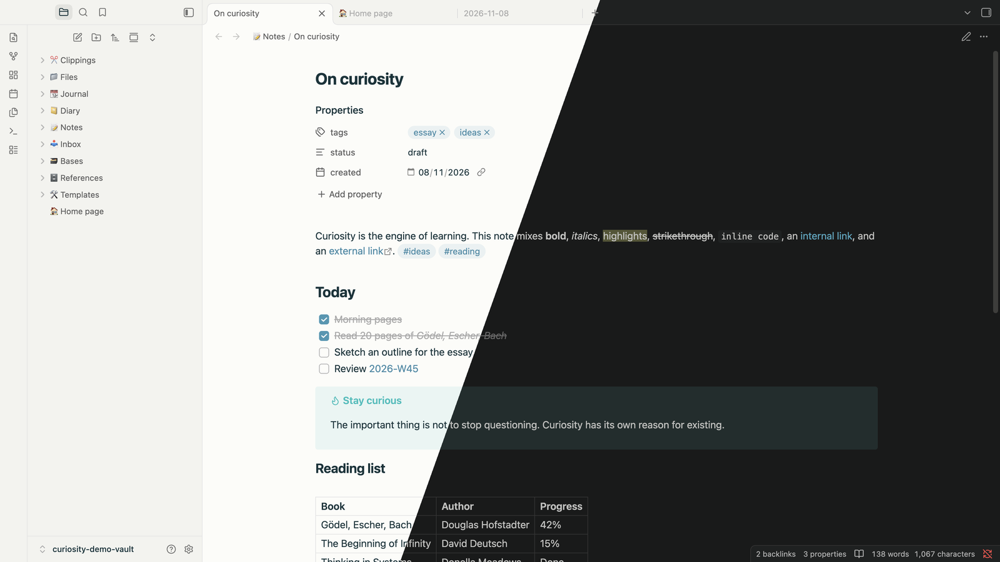

# Curiosity

A calm, minimal theme for [Obsidian](https://obsidian.md).

## Installation

1. Open **Settings → Appearance**.
2. Under **Themes**, click **Manage**.
3. Search for **Curiosity** and click **Install and use**.

### Manual installation

Copy `theme.css` and `manifest.json` into `<your vault>/.obsidian/themes/Curiosity/`, then select **Curiosity** in **Settings → Appearance**.

## License

[MIT](LICENSE)
